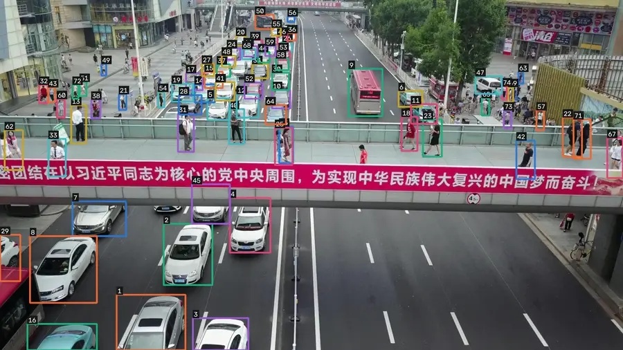
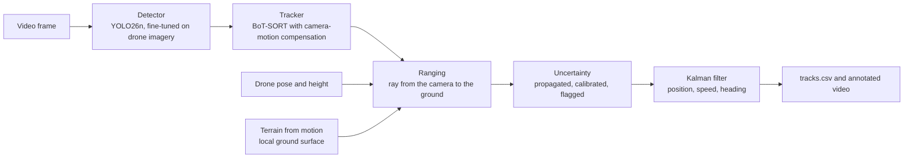
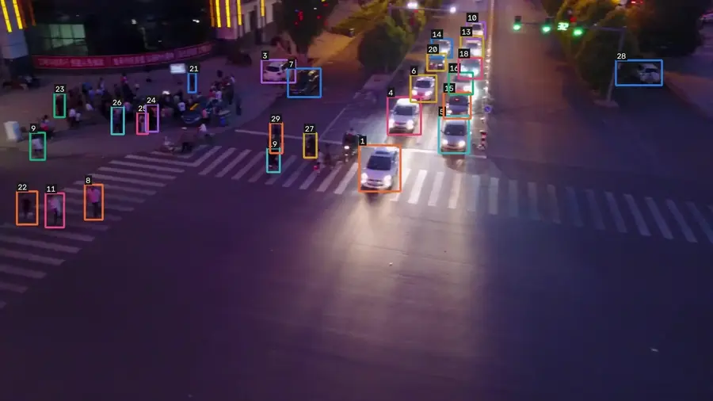
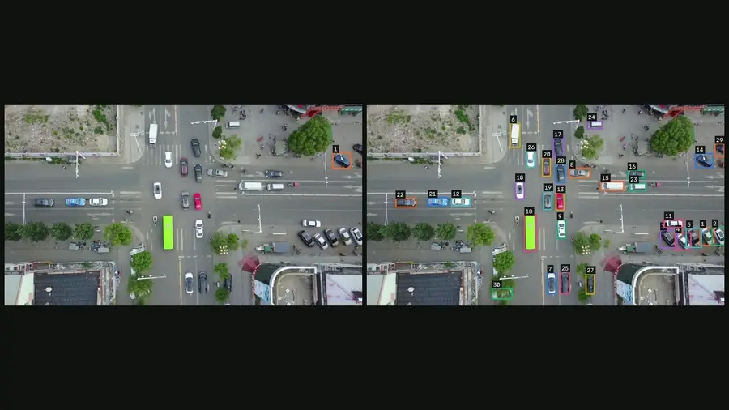
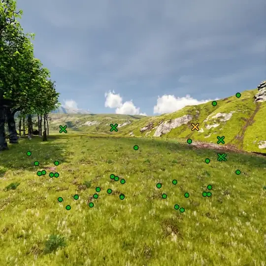
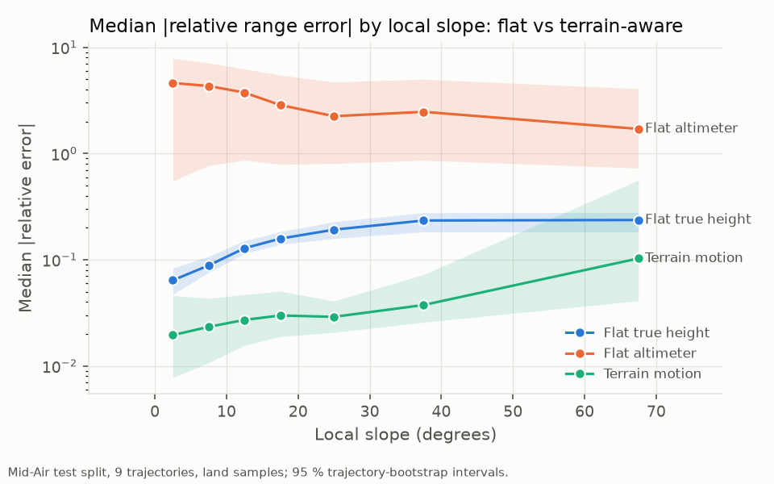
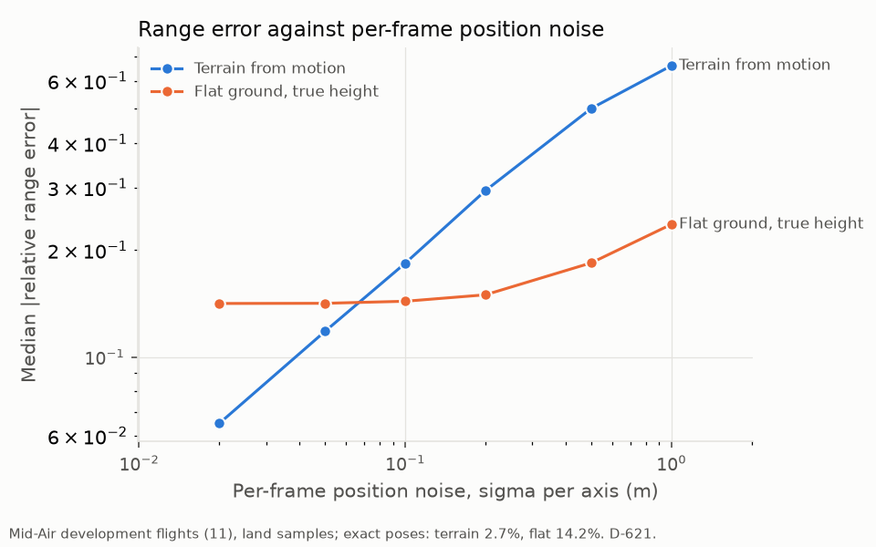
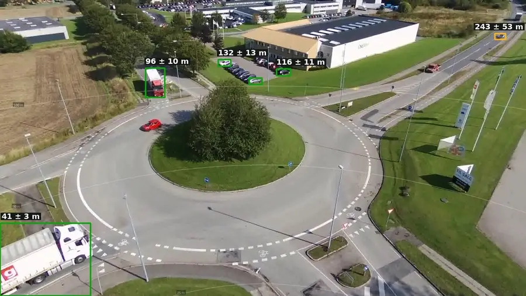
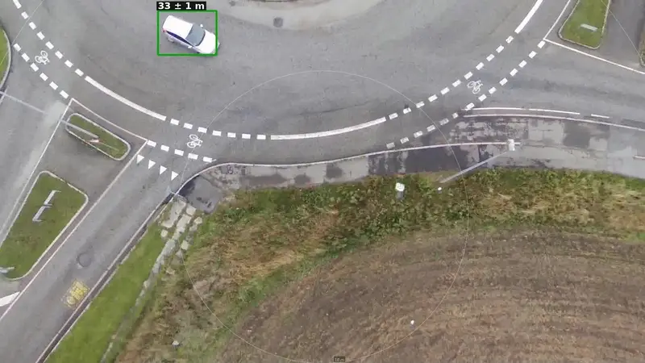
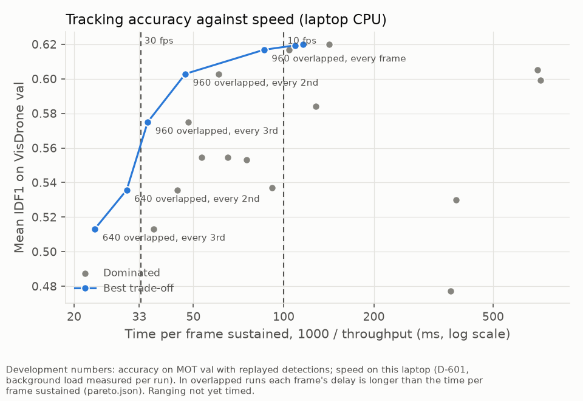

<!-- Generated by scripts/build_docs.py from docs/src/README.md; edit the template. -->
<div align="center">

# Aerial Track and Range

**Detect and track people and vehicles from a single drone camera, estimate how far away each one is with an error bar, and run on a laptop CPU.**

**[Luke Andrew](https://lukeandrew.dev)**




<sub>VisDrone test-dev, the held-out test set, never used for training or tuning: the fine-tuned detector and tuned tracker, each colour and number one identity kept across frames. Clips chosen for clarity; across the whole test set, identity F1 is 0.760 for vehicles and 0.436 for people.</sub>

</div>

## Results at a glance

Every number on this page is generated from a results file in [`results/`](results/) by code in this repository. Each test split was run once, after all settings were frozen.

| | Result | Data |
|---|---|---|
| **Distance accuracy** | Median error **2.4%** (95 % interval 1.6% to 3.9%) against 14.7% for flat ground given the true height, on the same samples; 90th percentile 35% against 64% | Mid-Air, 9 synthetic test flights with exact truth; the 78% of samples where both methods give an answer |
| **With realistic errors** | With assumed typical navigation errors the median rises to **11.7%** (flat ground: 40%); ranging a detected car's box rather than a ground point adds a 3% short bias, 5.6% end to end even with exact poses | Mid-Air, 11 development flights; simulated boxes |
| **Error bars** | After calibration, nominal 90 % intervals contain the truth **84%** of the time (74% before): short of 90 %, a sign that flights differ more than calibration assumes | Mid-Air test |
| **Tracking** | Identity F1 **0.760** for vehicles, 0.436 for people; only 16% of people 16 to 32 pixels tall are tracked | VisDrone test-dev; a standard detector and tracker, fine-tuned |
| **Real footage** | Parked vehicles' positions repeat to **7.6%** of their distance (repeatability, not accuracy); the detector reaches AP50 only **0.21** for vehicles and 0.02 for people here | AU-AIR, held-out flights |
| **Speed** | **9.6 frames per second** at full accuracy; 33.4 with detection on every second frame. Mean IDF1 on validation 0.617 and 0.536 (not comparable with the test-set tracking row) | AMD Ryzen 7 5700U with Radeon Graphics, no GPU |

## How it works



A camera gives direction, not distance. Each tracked box's ground-contact point is turned into a ray and intersected with the ground: either a flat plane, or a local surface triangulated from image features tracked across frames using the drone's known motion ("terrain from motion"), which needs no height above the ground. Sensor noise is propagated to every range, the intervals are calibrated on separate flights (split conformal prediction), and a small, interpretable model flags estimates that are likely to be badly wrong.

## 1. Detect and track

<p align="center">
  
</p>

A YOLO26n detector fine-tuned on VisDrone, with the BoT-SORT tracker and camera-motion compensation, its thresholds tuned on validation data. Each colour and number is one identity kept across frames. The clip above is from test-dev (night, held out), replayed from the saved one-time test run.

<p align="center">
  
</p>

**Left:** the off-the-shelf detector. **Right:** after fine-tuning and tuning. This comparison is on a validation clip, the data the thresholds were tuned on, because the off-the-shelf baseline was never run on test-dev. Mean identity F1 on validation rises from 0.32 to 0.62. On the test set, vehicles reach IDF1 0.760 (MOTA 0.635) and people 0.436. This is a standard detector-and-tracker design, and most of the gain comes from fine-tuning on drone imagery; it is not compared with published VisDrone tracking results, whose protocol (classes and test split) differs. Small people are the weak point: 16% are found at 16 to 32 pixels tall, against 91% above 128.

## 2. Range with honest uncertainty

<table>
<tr>
<td width="42%"></td>
<td></td>
</tr>
</table>

On synthetic flights, where the true distance of every pixel is known, each dot is a range estimate that stays on its spot on the ground: **circles** were within 10 % of the truth and **crosses** were not; **amber** means the reliability flag was raised. Compared on the same samples with flat ground given the true height (a height a real drone does not have), terrain from motion has a median error of 2.4% against 14.7% and is closer on 78% of samples; it has the lower median on 8 of 9 flights, but not on flight 5 (17.1% against 10.3%), and one estimate in ten is still more than 35% off. Its error stays at or below 3.7% on slopes up to 45°; a flat-ground model, even given the true height, grows from 6% on level ground to 24% on slopes above 45°. After calibration, 90 % error bars hold only 84% of the time: calibration assumes the test flights resemble the calibration flights, and the shortfall shows they do not quite; the flag (AUROC 0.68) catches 56% of estimates more than 10 % off.

### How far the number transfers

The figures above give the method the simulator's exact camera poses and an ideal camera. A real drone's navigation is not exact, so every pose the method uses was perturbed and the development flights re-run ([pose sweep](scripts/terrain_pose_sweep.py)). On these development flights, exact poses give 2.7% for terrain from motion and 14.2% for flat ground given the true height (the test-flight figures above are on different flights and samples).

<p align="center">
  
</p>

- **Errors shared by every frame do not matter much.** A 5 m GPS offset leaves terrain from motion at 2.7% (flat ground: 67%), and a 2° tilt error raises it only to 4.5%, because the camera and the triangulated ground move together.
- **Errors that change from frame to frame matter a lot.** Triangulation uses frames 0.04 to 0.4 s apart, so it needs the change in pose between them to be accurate: per-frame position noise of 2 cm gives 6.5%, 10 cm gives 18.4% (worse than flat ground with the true height, 14%), and attitude noise of 0.1° gives 6.3%. In practice this calls for the short-term accuracy of an inertial or visual-inertial navigation system, not raw GNSS.
- **Three assumed navigation grades** (combining both kinds of error; assumptions, not product specifications) give 6.6%, 11.7% and 40%, against 22%, 40% and 78% for flat ground given the true height.
- **The box adds its own error.** The pipeline ranges a detected box's bottom-centre, which for a car seen at an angle is the near edge, not the centre. Simulated cars with the detector's measured box noise read 3.0% short (people 0.5%); combined with the ranging error, a car is 5.6% off at the median and more than 36% off one time in ten, even with exact poses.

Lens distortion, rolling shutter and focal-length error are not modelled: Mid-Air renders an ideal camera.

## 3. Real footage

<table>
<tr>
<td width="50%"></td>
<td width="50%"></td>
</tr>
</table>

AU-AIR records real flights with GPS and altitude but no camera calibration and no camera tilt, so both were estimated: the focal length from GPS motion against image motion on separate calibration flights (1259 px), and the tilt, frame by frame, from the motion of the ground in the footage itself ([camera model](docs/auair_camera_model.md)). On held-out flights, parked vehicles' estimated positions repeat to 7.6% of their distance (343 vehicle segments). There is no ground truth here, so this is repeatability, not accuracy. The detector itself transfers poorly to this footage: AP50 0.21 for vehicles and 0.02 for people on the held-out flights, partly because AU-AIR's boxes are drawn looser than VisDrone's (D-512); the rest is a genuine gap between the two datasets, and many vehicles are missed. Two further warning signs: the tilt is estimated from the same footage it is used on, and 11% of vehicle tracks imply speeds above 70 km/h at a junction where that is implausible, most likely from shallow lines of sight and identity switches.

## 4. Speed on a laptop CPU

<p align="center">
  
</p>

Every setting was measured on the same laptop CPU (AMD Ryzen 7 5700U with Radeon Graphics). At full accuracy (ONNX, 960-pixel input, detection on every frame) the pipeline runs at **9.6 frames per second** (mean IDF1 on validation 0.617). To reach video rate, a 640-pixel input, detection on every second frame (the tracker predicts in between) and detection overlapped with tracking give 33.4 frames per second, at the cost of mean validation IDF1 0.536. Each frame's result then arrives 47 ms after capture (median), so 30 fps is met in throughput, not in per-frame delay.

## Quick start

```bash
python -m venv .venv
.venv/Scripts/python -m pip install -r requirements-lock.txt     # .venv/bin/python on Linux or macOS
.venv/Scripts/python -m pip install -e . --no-deps
.venv/Scripts/python -m pytest                                   # run the test suite
.venv/Scripts/aerialrange demo --out cache/demo                  # full pipeline on a synthetic flight, no datasets needed
```

The demo writes `tracks.csv`, `annotated.mp4` and `timing.json`, and checks every distance and speed against the synthetic truth. To run on a real flight (frames or a video, plus a flight-data CSV with position, height, heading and camera tilt per frame):

```bash
.venv/Scripts/aerialrange run --source <frames-or-video> --metadata <flight.csv> --out cache/run
```

## Documentation

| Document | What it covers |
|---|---|
| [Technical brief](docs/brief.md) | Two-page summary: problem, method, results, failure modes |
| [Limitations, and questions and answers](docs/limitations.md) | Where it breaks, by how much, and the questions an engineer is likely to ask |
| [Model and data](docs/model_and_data.md) | Detector, tracker, datasets and licences |
| [AU-AIR camera model](docs/auair_camera_model.md) | Focal length, tilt and altitude inferred from footage |
| [Decision log](docs/decisions.md) | Every design choice, with its reason and evidence |
| [Runbook](docs/runbook.md) | The commands that reproduce each result, in order |

## Repository layout

| Path | Contents |
|---|---|
| `src/aerialrange/geometry/` | Camera model, ranging, uncertainty propagation, triangulation, terrain fitting, Kalman filter (built test-first) |
| `src/aerialrange/track/`, `detect/` | Tracking, evaluation, tiling, saved-detection replay |
| `src/aerialrange/evaluate/` | Mid-Air and AU-AIR evaluations, conformal calibration, reliability flag, statistics |
| `src/aerialrange/pipeline/` | The end-to-end `aerialrange run` and `demo` |
| `src/aerialrange/edge/` | Latency benchmark harness |
| `scripts/` | One script per experiment |
| `configs/` | Every setting, each with its source |
| `results/` | Every number and figure quoted in the documents |


## The main gap

No single test runs detect, track and range end to end against known object distances. Tracking is scored on VisDrone (boxes, no distances), ranging on Mid-Air (distances, no objects; exact poses) and real footage on AU-AIR (neither true distances nor a well-transferred detector). The box-to-ground simulation and the pose-noise sweep narrow the gap but are still separate pieces. The most valuable next step is one setup where every object's distance is known: a drone flown past a car carrying a GPS logger, or a simulator with vehicles and people (for example CARLA), scored through the whole pipeline.

## Scope

A perception and measurement project on public research datasets. People and vehicles are tracked as boxes only: no face analysis and no re-identification by appearance. Distances hold under stated assumptions (a known camera and pose, and flat ground or terrain from motion) and are not claimed beyond the tested conditions: low altitude (3 to 31 m on real footage), short ranges, and one site for real footage.

## Datasets and credits

No datasets or model weights are stored in this repository; the short clips in `docs/media/` contain frames from the datasets below and are shared under their terms.

- **VisDrone2019**: P. Zhu, L. Wen, D. Du et al., "Detection and tracking meet drones challenge", *IEEE TPAMI*, 2021. Research use.
- **Mid-Air**: M. Fonder and M. Van Droogenbroeck, "Mid-Air: a multi-modal dataset for extremely low altitude drone flights", *CVPR Workshops*, 2019. CC BY-NC-SA 4.0.
- **AU-AIR**: I. Bozcan and E. Kayacan, "AU-AIR: a multi-modal unmanned aerial vehicle dataset for low altitude traffic surveillance", *ICRA*, 2020. CC BY 4.0.
- Detector and trackers: [Ultralytics](https://github.com/ultralytics/ultralytics) (AGPL-3.0).

## Licence

[GNU Affero General Public License v3.0 only](LICENSE). The detector and trackers come from Ultralytics, which is AGPL-3.0, so code combined with it must be released under the same terms; in practice, it cannot go into a closed product as it stands. Only two modules use Ultralytics (`src/aerialrange/track/runner.py` and `src/aerialrange/pipeline/run.py`). The ranging, uncertainty and evaluation code (`src/aerialrange/geometry/`, `src/aerialrange/evaluate/`) does not, and I am happy to discuss a permissive licence for those parts.

## Author

**Luke Andrew**, [lukeandrew.dev](https://lukeandrew.dev), [GitHub](https://github.com/LukeA77).
