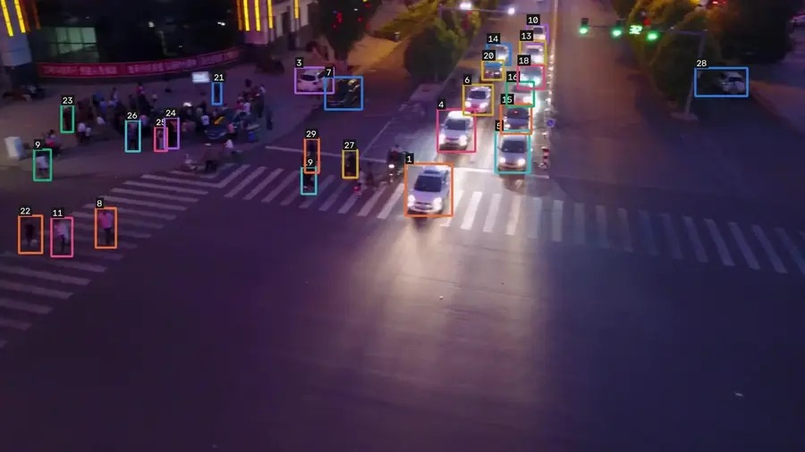
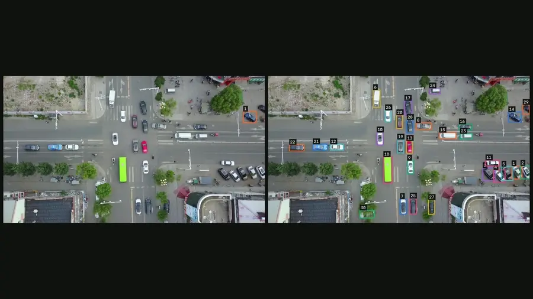

<!-- Generated by scripts/build_docs.py from docs/src/results.md; edit the template. -->
# All results

Every headline result of the project, with the data and conditions behind it. Each number is generated from a results file in [`results/`](../results/) by code in this repository, and each test split was run once, after all settings were frozen. The [README](../README.md) gives the short version; the linked documents give the method and the limits of each result.

## Headline results

| | Result | Data |
|---|---|---|
| **Distance accuracy** | Median error **2.4%** (95 % interval 1.6% to 3.9%) against 14.7% for flat ground given the true height, on the same samples; 90th percentile 35% against 64% | Mid-Air, 9 synthetic test flights with exact truth; the 78% of samples where both methods give an answer |
| **With realistic errors** | With assumed typical navigation errors the median rises to **11.7%** (flat ground: 40%); ranging a detected car's box rather than a ground point adds a 3% short bias, 5.6% end to end even with exact poses | Mid-Air, 11 development flights; simulated boxes |
| **Error bars** | After calibration, nominal 90 % intervals contain the truth **84%** of the time (74% before): short of 90 %, a sign that flights differ more than calibration assumes | Mid-Air test |
| **Tracking** | Identity F1 **0.692** for vehicles, 0.321 for people, with a detector and tracker that contain no copyleft code; 38% of people 16 to 32 pixels tall are detected but only 6% tracked. Version 1 reached 0.760 and 0.436 at higher input resolution, with AGPL-licensed code ([version 1 results](#version-1-results)) | VisDrone test-dev, run once |
| **End to end** | Ranges of found objects within **0.6%** (people) and **0.4%** (vehicles) median, calibrated error bars holding (90 % intervals: 95% and 93%); but people found only **47%** of the time from 20 m, 6% from 50 m and 0.4% from 80 m, with 393 false person tracks per km2; vehicles found 69% to 81% at every height | SynDrone, 3 rendered test towns, 9 flights, exact poses, run once |
| **Search with several drones** | When a find must be confirmed for the crew (two detections at one place) and false alarms come back to the same places, a new plan, sweep first then look again, is as fast as a plain lawnmower sweep (four drones: **1,066 s** against 1,024 s to a confirmed find), loses about half as much time when a drone is lost (+196 s against +365 s), and shares only 34 bytes per drone per second. Phase 14's map-guided sharing, which lost to the lawnmower even before confirmation, fails in this world (3,758 s). The open problem is false alarms: about 1,861 places reported to the crew before the person ([multi-drone search](multi_drone.md)) | Simulation with the camera measured on SynDrone, 300 searches per setting, run once (Phases 14 and 16) |
| **Real footage** | Parked vehicles' positions repeat to **7.6%** of their distance (repeatability, not accuracy). The version 2 detector reaches AP50 only **0.20** for vehicles and 0.04 for people here, about the same as version 1's 0.21 and 0.02 | AU-AIR, held-out flights |
| **Thermal camera** | A detector trained on thermal images finds people on capture days it never saw: person AP50 **0.69** (95 % interval 0.56 to 0.79), by night as well as by day; the colour detector scores 0.06 on the same images. On another thermal camera (BIRDSAI night patrols over wildlife areas, one-time test) it does not yet carry over: 20% of its person tracks are people, person IDF1 0.14. [Thermal](thermal.md) | HIT-UAV, two held-out capture days, 678 images; BIRDSAI, 16 test videos |
| **Speed** | **12.7 frames per second** on a laptop CPU with detection on every second frame. On a Raspberry Pi 5 the detector is *estimated* (not measured) at about 285 ms per frame; the same program runs on ARM64 with outputs matching x86 | AMD Ryzen 7 5700U with Radeon Graphics, no GPU; ARM64 under emulation |

## Version 1 results

Version 1 used a YOLO26n detector fine-tuned on VisDrone with Ultralytics' BoT-SORT tracker. On VisDrone test-dev (run once) it reached identity F1 0.760 for vehicles (MOTA 0.635) and 0.436 for people, with 16% of people 16 to 32 pixels tall tracked (91% above 128). Fine-tuning on drone imagery raised mean validation IDF1 from 0.32 to 0.62. On the laptop CPU it ran at 9.6 frames per second at full accuracy and 33.4 in its fastest setting.

  

  

Version 1's test-dev run (night clip, held out) and, on a validation clip, the off-the-shelf detector (left) against the fine-tuned one (right).

