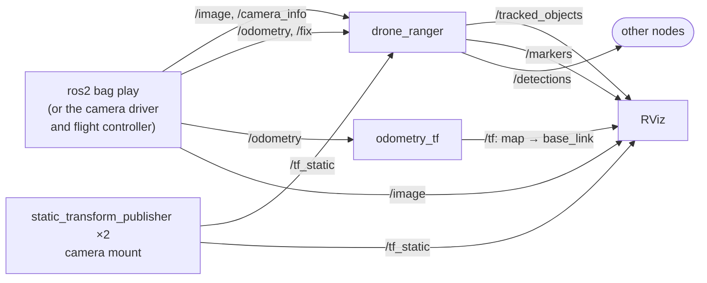

# ROS 2 node (Phase 12)

Drone Ranger runs as a ROS 2 node, so it can sit on a drone's onboard computer next to its autopilot and camera drivers. It takes the camera, the drone's odometry and GPS, and publishes every tracked person and vehicle with a ground position, a range and their error bars.

**Platform:** ROS 2 Jazzy Jalisco on Ubuntu 24.04, in Docker (`docker/ros2.Dockerfile`), for x86-64 and ARM64 (Raspberry Pi 5).

## Try it

Two commands with Docker. You don't need ROS, datasets or model weights:

```bash
docker build -f docker/ros2.Dockerfile -t drone-ranger-ros:amd64 .
docker run --rm -v "$PWD/out:/out" drone-ranger-ros:amd64 \
  ros2 launch drone_ranger_ros demo.launch.py rviz:=false output_dir:=/out
```

`demo.launch.py` plays a recording into the node and stops when the recording ends. The node then writes `tracks.csv`, `map.html` and `timing.json` to `out/`. Without a `bag` argument it plays the demo recording built into the image. That recording is a **synthetic flight, not real footage**: a camera 25 m up flies over flat ground past three cars, one parked and two driving. The boxes come from the scene, so no detector runs, and the cars' true positions are known. The map is placed at latitude 0, longitude 0, because the flight has no real location.

To watch it in RViz, build `docker/ros2-viz.Dockerfile` as well and run the same launch file with a display (the Dockerfile shows the command for a Linux desktop). On your own recording: `demo.launch.py bag:=<recording> mount_tilt_deg:=<degrees>`. `make_bag` turns frames and flight data into a recording.

The README's RViz clip is the same launch file on AU-AIR clip 35 (real footage, with the detector), recorded by `scripts/record_rviz.sh`. The script runs RViz on a virtual display inside the container, so it needs no desktop or graphics card. Rendering RViz in software takes CPU from the detector on the same laptop, so I played the recording at 0.35× speed. At that speed the node kept up, processing 316 of the 318 frames. At 0.5× it dropped 13. `scripts/make_readme_media.py` then speeds the clip back to real time. The mount angle for AU-AIR is 0°, because AU-AIR records the camera's angle, not the drone's, so `base_link` stands for the camera body there.

## Nodes and topics



On a drone, the camera driver and the flight controller take the place of `ros2 bag play`. The flight controller usually broadcasts `map → base_link` itself, so `odometry_tf` isn't needed there (`drone_ranger.launch.py` has it off by default).

## Topics

| Direction | Topic | Type | Notes |
|---|---|---|---|
| in | `image` | `sensor_msgs/Image` | bgr8, rgb8 or mono8; sensor-data quality of service |
| in | `camera_info` | `sensor_msgs/CameraInfo` | the pinhole intrinsics replace the config's camera |
| in | `odometry` | `nav_msgs/Odometry` | body (forward, left, up) in a world frame (east, north, up) |
| in | `fix` | `sensor_msgs/NavSatFix` | anchors the map; the first fix sets the map's origin |
| in | `/tf`, `/tf_static` | tf2 | the camera's pose on the body: `base_link` to the image's frame |
| out | `detections` | `vision_msgs/Detection2DArray` | the detector's raw boxes |
| out | `tracked_objects` | `drone_ranger_msgs/TrackedObjectArray` | see below |
| out | `markers` | `visualization_msgs/MarkerArray` | for RViz: an error ellipse, a label with the range, and a line from the camera to each object |

The four inputs are matched by time stamp (`message_filters`, approximate time, 0.1 s). At shutdown the node writes `tracks.csv` (the same columns as `aerialrange run`), `map.geojson` and `map.html` (docs/map.md), and `timing.json` into `output_dir`.

Each `TrackedObject` carries:
- the track number and class (people are a class and a number only);
- the image box;
- the ground position and its 2 × 2 covariance;
- the range with its sigma and calibrated 68 / 90 / 95 % intervals;
- whether a range was found and why not;
- the reliability flag;
- a velocity with covariance, only where the display rule shows the speed.

## Frames

ROS conventions (REP 103, REP 105) are east, north, up for the world and forward, left, up for the body. The pipeline works in north, east, down. All conversions are in `aerialrange/ros_bridge.py` and pinned by `tests/test_ros_bridge.py`.

The frame tree:

```
map ──(odometry)──> base_link ──(mount, static)──> camera_link ──(static)──> camera_optical_frame
```

- `map → base_link` is the drone's pose, from the flight controller (or `odometry_tf` for a recording).
- `base_link → camera_link` is the camera mount: forward, pitched down by `mount_tilt_deg`.
- `camera_link → camera_optical_frame` is the standard optical rotation (roll −90°, yaw −90°): z along the optical axis, x right and y down in the image. Images are stamped in this frame.

The node takes the body's pose from the odometry, matched to the image by time stamp. It takes the camera's pose on the body from tf2: the transform from the odometry's child frame to the image's frame, looked up at the image's time stamp. So the node works with any frame tree that connects the two. That includes a robot description, and a gimbal publishing a moving transform. If the transform isn't available within `tf_timeout_s` (1 s), the frame is skipped and logged. The pipeline's camera model has no roll about the optical axis, as in `aerialrange run`.

Two tests pin this down. `tests/test_ros_bridge.py` checks that the rotation `static_transform_publisher` builds from roll −90°, yaw −90° is exactly the optical frame. It also checks that, for 200 random attitudes, the camera pose through the frame tree equals the pose from the mount angle. The integration test then passes the mount to the node through tf2 only.

## Running

On a drone, `drone_ranger.launch.py` starts the node and publishes the camera mount:

```bash
docker run --rm -it -v "$PWD/weights:/app/weights:ro" drone-ranger-ros:amd64 \
  ros2 launch drone_ranger_ros drone_ranger.launch.py mount_tilt_deg:=30 output_dir:=/tmp/out \
  image:=/camera/image_raw camera_info:=/camera/camera_info odometry:=/odom fix:=/gps/fix
```

`--show-args` lists every argument. The main ones:

| Argument | Default | Meaning |
|---|---|---|
| `mount_tilt_deg` | (required) | the camera's tilt below the body's horizontal plane |
| `publish_mount_tf` | `true` | publish `base_link → camera_link → camera_optical_frame`; `false` if a robot description or gimbal driver already does |
| `publish_odom_tf` | `false` | broadcast the odometry as `map → base_link` |
| `config` | `run` | settings: a name in the repository's `configs/` |
| `image_qos` | `sensor_data` | `sensor_data` for a live camera (a late frame is dropped); `reliable` for every frame from a reliable publisher; `recording` for a recording played with `config/recording_qos.yaml` (transient local, so frames sent before the connection is made still arrive) |
| `boxes_csv` | (none) | read boxes from a CSV instead of running the detector |

The detector needs `weights/` mounted. The weights aren't in the repository.

## Integration test

`bash scripts/ros2_integration.sh <name> <frames dir> <flight CSV> <origin> [frames]`:

1. Builds the image.
2. Runs `aerialrange run` on the frames, as the reference.
3. Converts the same frames and flight data into a rosbag2 recording (`make_bag`).
4. Plays the recording into the node under `launch_testing`.
5. Checks that the node's output equals the reference: identical track numbers, classes and flags, and every number within 1e-6.

Results are in "Results" below.

**In CI**, on every push, `scripts/ros2_demo_check.sh` runs the same test on the built-in synthetic recording, so it needs no datasets or weights. It builds the ROS 2 image, runs `aerialrange run` as the reference, and plays the recording into the node under `launch_testing`, with the camera mount reaching the node through tf2. Every frame must be processed and every number must match within 1e-6. Then it runs `demo.launch.py` without a display, which must play to the end by itself and give the same tracks. `make ros2-check` runs it locally.

## Results

Run on the laptop (2026-11-10, `cache/ros2/<name>/`). All pass: every frame processed, and the node's output equal to `aerialrange run`'s in the same image.

| Recording | Frames | Rows compared | Result |
|---|---|---|---|
| AU-AIR clip 35 (real flight, D-FINE N) | 318 | 1,484 | identical within 1e-6 |
| SynDrone Town01, 50 m (simulated, its own camera) | 60 | 190 | identical within 1e-6 |
| AU-AIR clip 35, first 40 frames, **ARM64 image** (emulated, rate 0.01) | 40 | 86 | identical within 1e-6 |
| AU-AIR clip 35 again, camera mount through tf2 (2026-11-25, D-778) | 318 | 1,484 | identical within 1e-6 |
| Synthetic demo recording, mount through tf2 (CI, every push) | 80 | 150 | identical within 1e-6 |

The ARM64 run shows that the node builds and gives the same results on ARM64. It says nothing about speed: under emulation a frame takes about 9 s (median), which is the emulator, not the Pi.

**Latency on the laptop** (AU-AIR clip 35, medians, 95th percentile in brackets): the pipeline alone takes 106 ms (258 ms), and the node's whole callback, from the synchronised messages' arrival to the last publish, 120 ms (287 ms). So ROS 2 adds about 14 ms per frame on top of the pipeline: image conversion, building and publishing the messages.

**Raspberry Pi 5: estimated, not measured.** Scaled by the laptop-to-Pi ratio of `results/edge/pi_estimate.json` (2.72, range ×0.75 to ×1.5), that 14 ms would be about 38 ms (28 to 57 ms). The ratio was measured on neural-network inference, not on memory copies and message serialisation, so this figure is weaker than the pipeline's own estimate. It will be replaced when a Pi 5 is measured.

Five things the tests found, all fixed:
- **Dropped frames.** With best-effort delivery (ROS's default for cameras), 25 of 40 full-HD frames were lost. That is correct for a live camera, where a late frame is useless, so it stays the default. The `image_qos:=reliable` option delivers every frame of a recording.
- **Timestamp precision.** A time stamp near 1.7 billion seconds, held as one floating-point number, loses about 0.2 µs, which changed speeds by up to 5 parts per million. The node and the converter now work in whole nanoseconds.
- **Start-up race.** Under ARM64 emulation the node takes about a minute to start, and frames played before it subscribed were lost (38 of 40 arrived). The node now logs `subscribed: waiting for frames`, and the test starts playback on that line instead of after a fixed delay. A launch file on a drone can do the same.
- **Input queue overflow.** If frames arrive faster than the node processes them, its queue (10 frames) overflows and the oldest are lost (27 of 40 at rate 0.05 under emulation). On a live camera that is the intended behaviour. For a recording, the gap between frames during playback must be longer than the node's time per frame (`scripts/ros2_integration.sh` explains the choice of `RATE`).
- **First frame lost to discovery** (found by running the CI check repeatedly). About one run in three lost the recording's first frame. Playback had started before the player's publishers were connected to the node, and ROS's default delivery doesn't keep messages for subscribers that connect late. Recordings are now played with transient-local delivery (`config/recording_qos.yaml`), so the player keeps its last 10 messages for a late subscriber, and the node's `image_qos:=recording` mode subscribes to match.

## Limits

- ARM64 has been run only under emulation, on 40 frames; speed on a Raspberry Pi 5 is not measured.
- A gimbal can publish its moving transform through tf2, but that path has only been tested with fixed mounts.
- The image keeps Ubuntu's numpy 1.26, which ROS needs, so the libraries under the pipeline are older than in the laptop environment (`/app/requirements-ros-freeze.txt`). The comparison runs both sides in the same image; whether results differ between the two environments has not been checked.
