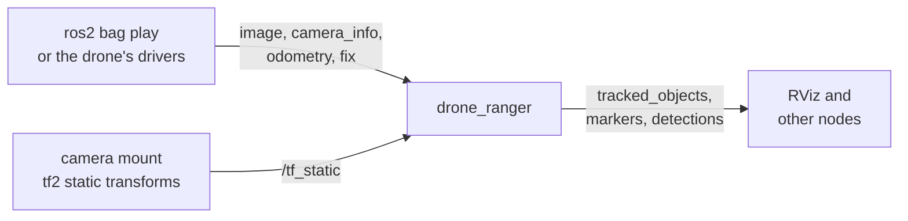
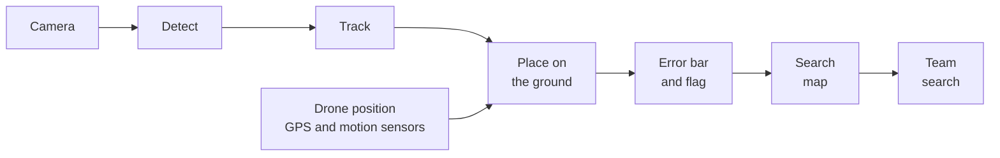

<div align="center">

# Drone Ranger

**Using a drone's camera, Drone Ranger maps where people and vehicles are on the ground below, and shows how confident it is in each position.**

The system is designed to run on a Raspberry Pi 5 carried on the drone itself, with no GPU and no internet connection.<br>
It is a research prototype. It has been tested on public datasets and in simulation, and has not yet been flown.

**[Luke Andrew](https://lukeandrew.dev)** · [LinkedIn](https://www.linkedin.com/in/luke-andrew-b54864316)

[](https://github.com/LukeA77/drone-ranger/actions/workflows/ci.yml)


<p align="center">
  
<br><sub>One flight, drawn from the system's own output. The drone's camera view is in the top-left corner, the ground it has searched is filled in, and every person and vehicle it identifies gets a pin. The town is simulated, so the drone's position is known exactly. The pins and the drone are drawn larger than life so they can be seen.</sub>
</p>

</div>

## In short

<table>
<tr><td width="170" valign="top"><b>What it is</b></td><td>A system that turns a drone's camera feed into positions on a map. Every person and vehicle it finds gets a distance and an error bar. It is designed to run on the drone itself, on a Raspberry Pi 5.</td></tr>
<tr><td width="170" valign="top"><b>Where it can be used</b></td><td><b>Search and rescue is the purpose of this project</b>, with a team of drones looking for a missing person. The same system can be used for anti-poaching patrols, site and perimeter security, and traffic and crowd surveys, and with a detector retrained for animals, for wildlife and livestock counts.</td></tr>
<tr><td width="170" valign="top"><b>What works</b></td><td>A distance to every person and vehicle, typically within {{RESULT:midair/test/navigation/ranging_msckf_final.json#conditions.fused.terrain.median|.1%}}. An error bar on every distance that holds up on test data. A search map built from the drone's own frames, with no map service. A team of drones that plan the search together, split the area between them, and take over the ground of any drone that is lost.</td></tr>
<tr><td width="170" valign="top"><b>What it struggles with</b></td><td>Finding people from high up. From above 20 m it misses most people, and it raises far too many false alarms. It has also not been flown yet, only tested on public datasets and in simulation.</td></tr>
</table>

I tested it on search and rescue, with a team of drones looking for one missing person in simulation. Four findings came out of that. Two are good, and two set the next work.

<table>
<tr>
<td align="center" width="25%" valign="top"><b>Distance error</b><h2>{{RESULT:midair/test/navigation/ranging_msckf_final.json#conditions.fused.terrain.median|.1%}}</h2>typical, over uneven ground</td>
<td align="center" width="25%" valign="top"><b>Error bars correct</b><h2>{{RESULT:headline.json#midair_test.cov_cal_90|.0%}} to {{RESULT:syndrone/test/eval_p10_v2_cal.json#person.pooled.range_calibrated_coverage_0.90|.0%}}</h2>of the time, against a 90% target</td>
<td align="center" width="25%" valign="top"><b>Time saved</b><h2>{{RESULT:multi_drone/phase16_paired_test.json#comparisons.H15_lose_cost_sweep_minus_lawnmower.time.mean|neg:,.0f}} s</h2>when a drone is lost, by searching as a team instead of on fixed lanes</td>
<td align="center" width="25%" valign="top"><b>People found</b><h2>{{RESULT:syndrone/test/search_p10_v2_cal.json#person.by_height.h20.found_share|.0%}} and {{RESULT:syndrone/test/search_p10_v2_cal.json#person.by_height.h50.found_share|.0%}}</h2>from 20 m and from 50 m. The camera is the limiting factor.</td>
</tr>
</table>

## Running in ROS 2

<p align="center">
  
<br><sub>The ROS 2 node on real drone footage (AU-AIR), played from a recording and shown in RViz at real speed. Left: the drone's camera. Right: the drone's frame tree and every tracked vehicle (orange) and person (blue) on the ground, with its error ellipse, a line from the camera, and its distance.</sub>
</p>

You can run it with two commands. You need Docker, but not ROS, the datasets or the model weights:

```bash
docker build -f docker/ros2.Dockerfile -t drone-ranger-ros:amd64 .
docker run --rm -v "$PWD/out:/out" drone-ranger-ros:amd64 \
  ros2 launch drone_ranger_ros demo.launch.py rviz:=false output_dir:=/out
```

The model weights aren't shared, so this demo plays a synthetic flight built into the image, with the cars' true positions known. The node writes `tracks.csv` and a map to `out/`. On every push, CI plays the same recording into the node under `launch_testing`, with the camera mount passed through tf2, and checks that the node's output matches the Python pipeline to within 1e-6.



The [ROS 2 page](docs/ros2.md) has the full node graph, the frame tree (`map → base_link → camera_link → camera_optical_frame`), the launch arguments and the test results.

## Four findings

### 1. Distances are typically within {{RESULT:midair/test/navigation/ranging_msckf_final.json#conditions.fused.terrain.median|.1%}}

A camera gives a direction, not a distance. Drone Ranger follows the line of sight to each person or vehicle down to the ground and reports how far away they are. With the drone's position known, the typical (median) error is {{RESULT:syndrone/test/eval_p10_v2_cal.json#person.pooled.range_rel_err_median_abs|.1%}} for people and {{RESULT:syndrone/test/eval_p10_v2_cal.json#vehicle.pooled.range_rel_err_median_abs|.1%}} for vehicles. When the drone has to work out its own position from its camera, motion sensor and GPS, it is {{RESULT:midair/test/navigation/ranging_msckf_final.json#conditions.fused.terrain.median|.1%}}.

<p align="center"><picture>
  <source media="(prefers-color-scheme: dark)" srcset="docs/media/fig_distance_dark.png">
  
</picture></p>

### 2. The error bars contain the true distance {{RESULT:headline.json#midair_test.cov_cal_90|.0%}} to {{RESULT:syndrone/test/eval_p10_v2_cal.json#person.pooled.range_calibrated_coverage_0.90|.0%}} of the time

Every distance comes with an error bar, because a number you cannot trust is worse than no number. The bars are calibrated on separate flights and then checked on test data. A 90% error bar should contain the true distance 9 times out of 10. On the test data, the true distance was inside the bar {{RESULT:headline.json#midair_test.cov_cal_90|.0%}} to {{RESULT:syndrone/test/eval_p10_v2_cal.json#person.pooled.range_calibrated_coverage_0.90|.0%}} of the time, up from {{RESULT:headline.json#midair_test.cov_raw_90|.0%}} before calibration on the hardest test set. A separate warning flag marks the distances most likely to be badly wrong. So far it catches {{RESULT:headline.json#midair_test.flag_recall|.0%}} of them.

<p align="center"><picture>
  <source media="(prefers-color-scheme: dark)" srcset="docs/media/fig_error_bars_dark.png">
  
</picture></p>

<p align="center">
  
<br><sub>Real footage (AU-AIR), with version 1's detector.</sub>
</p>

### 3. Searching as a team saves {{RESULT:multi_drone/phase16_paired_test.json#comparisons.H15_lose_cost_sweep_minus_lawnmower.time.mean|neg:,.0f}} s when a drone is lost

Four drones split the area into lanes and tell each other which lanes they have finished. Each drone sends about {{RESULT:multi_drone/phase16_test.json#results.sweep_n4.bytes_per_drone_s_mean|,.0f}} bytes a second, small enough for a basic radio. If a drone goes silent, the others treat it as lost and fly the lanes it had not finished.

I compared this with the usual plan, where each drone keeps to its own fixed lanes. Over {{RESULT:video/demo_team.json#end_card.test_searches|d}} simulated searches, losing one of four drones added {{RESULT:multi_drone/phase16_paired_test.json#comparisons.sweep_lose_any_minus_no_loss.time.mean|,.0f}} s to a search done as a team, against {{RESULT:multi_drone/phase16_paired_test.json#comparisons.lawnmower_lose_any_minus_no_loss.time.mean|,.0f}} s on fixed lanes. With no drone lost, neither plan was measurably faster.

<p align="center">
  
<br><sub>One simulated search where the lost drone matters, because the missing person was on its ground. It was chosen by a written rule as the typical case of this kind. Searching as a team, the drones found and confirmed the person after {{RESULT:video/demo_team.json#team_plan.t_confirmed_s|min:.0f}} minutes. On fixed lanes they had not found them when the search was called off at {{RESULT:video/demo_team.json#fixed_lanes.searched_until_s|min:.0f}} minutes. A case like this came up in {{RESULT:video/demo_team.json#end_card.cases_like_this.0|d}} of {{RESULT:video/demo_team.json#end_card.cases_like_this.1|d}} trial searches.</sub>
</p>

<p align="center"><picture>
  <source media="(prefers-color-scheme: dark)" srcset="docs/media/fig_lost_drone_dark.png">
  
</picture></p>

### 4. The camera limits the search, not the flight plan

From 20 m the camera finds {{RESULT:syndrone/test/search_p10_v2_cal.json#person.by_height.h20.found_share|.0%}} of people. From 50 m it finds {{RESULT:syndrone/test/search_p10_v2_cal.json#person.by_height.h50.found_share|.0%}}. So the drones have to fly low, and flying low is slow. Four drones take {{RESULT:multi_drone/search_speed_by_height.json#by_height.h20.sweep_min|.0f}} minutes to cover an area from 20 m that they could cover in {{RESULT:multi_drone/search_speed_by_height.json#by_height.h80.sweep_min|.0f}} minutes from 80 m.

<p align="center"><picture>
  <source media="(prefers-color-scheme: dark)" srcset="docs/media/fig_height_dark.png">
  
</picture></p>

The system also raises too many false alarms, places it reports as a person where there is none. To cut them, a place is reported to the search crew only after it has been seen twice. On average, that cuts the false alarms before the real person is found from {{RESULT:multi_drone/phase16_test.json#results.sweep_n4.false_alarms_before_find_mean|,.0f}} to {{RESULT:multi_drone/phase16_test.json#results.sweep_n4.crew_alarms_before_find_mean|,.0f}} per search. That is still far more than a crew could check.

<p align="center"><picture>
  <source media="(prefers-color-scheme: dark)" srcset="docs/media/fig_false_alarms_dark.png">
  
</picture></p>

<p align="center">
  
<br><sub>The whole two-minute flight, sped up. Grey rings are false alarms. {{RESULT:video/field_view.json#flight.counts_at_end.false|d}} of the {{RESULT:video/field_view.json#flight.counts_at_end.people|d}} “people” were look-alikes.</sub>
</p>

**Both problems have the same cause.** The detector learned from city streets filmed from lower down, where people look bigger. From search height a person is only a few pixels, and so are many fixed objects. Most false alarms come back to the same places on every pass. Three things would help.

- **A thermal camera.** People show up warm against cool ground. A detector I trained on thermal images already finds people on days it never saw, by night as well as by day. It scores {{RESULT:thermal/detect_dfine_hituav_day_coco_day_test.json#groups.person.ap50.ap|.2f}}, against {{RESULT:thermal/detect_visdrone_dfine_n_640_day_test.json#groups.person.ap50.ap|.2f}} for the colour detector (person AP50, a standard detection score from 0 to 1). On a different thermal camera, over wildlife areas at night, only {{RESULT:birdsai/test/grid_dfine_hituav_day_coco__motion__person_test.json#points.0.metrics.person.OVERALL.precision|.0%}} of what it tracks as people are people. The next step is to train it on that kind of video. More in [thermal](docs/thermal.md).
- **Training on footage filmed from search height**, so the detector learns what a person looks like from that far up.
- **A closer second look** as soon as something is seen, instead of waiting for the next pass.

<p align="center">
  
<br><sub>Two test days the detector never saw, night above day. Each is the test image with the most people, shown in false colour (the camera records greyscale). At night, from {{RESULT:thermal/example.json#night.altitude_m|d}} m, {{RESULT:thermal/example.json#night.people_labelled|d}} people are labelled. The colour detector boxes {{RESULT:thermal/example.json#night.detectors.0.person_boxes|d}} of them and the thermal detector {{RESULT:thermal/example.json#night.detectors.1.person_boxes|d}}, of which {{RESULT:thermal/example.json#night.detectors.1.people_found|d}} match a labelled person closely enough to count. By day, from {{RESULT:thermal/example.json#day.altitude_m|d}} m, the colour detector boxes {{RESULT:thermal/example.json#day.detectors.0.person_boxes|d}} people and the thermal detector {{RESULT:thermal/example.json#day.detectors.1.person_boxes|d}}. This day image is a hard case. Over all test images, the thermal detector does as well by day as by night. HIT-UAV, CC BY 4.0.</sub>
</p>

**Real footage is the weakest test so far.** On the one real drone dataset (AU-AIR, traffic filmed from low altitude at one site), the current detector does no better than the earlier one. On recordings it had never seen, it scored a person AP50 of {{RESULT:auair/detect_v2_dfine_n_640_held_out.json#results.person.ap50.ap|.2f}} and a vehicle AP50 of {{RESULT:auair/detect_v2_dfine_n_640_held_out.json#results.vehicle.ap50.ap|.2f}}, against {{RESULT:auair/detect_v2_dfine_n_640_held_out.json#version1.ap50.person|.2f}} and {{RESULT:auair/detect_v2_dfine_n_640_held_out.json#version1.ap50.vehicle|.2f}} for the earlier detector. At its most sensitive it finds {{RESULT:auair/detect_v2_dfine_n_640_held_out.json#results.person.ap50.max_recall|.0%}} of people and {{RESULT:auair/detect_v2_dfine_n_640_held_out.json#results.vehicle.ap50.max_recall|.0%}} of vehicles. Positions of parked cars repeated to within {{RESULT:headline.json#auair.heldout_rel_all|.1%}} of their distance. That measures consistency, not accuracy. The next step is a real flight past people and vehicles at known positions.

## What it does

- **Maps what the camera sees.** Each person and vehicle is followed from frame to frame and pinned on a map built from the drone's own frames, with no map service. A counter shows people found, vehicles found, ground searched and flight time. A crew confirms or dismisses each find ([search map](docs/map.md)).
- **Gives every distance an error bar,** and flags the ones likely to be badly wrong.
- **Searches as a team** over an unreliable radio, and covers for a drone that is lost ([team search](docs/multi_drone.md)).
- **Runs on small hardware.** It processes {{RESULT:headline.json#v2.val_dfine_n_640_laptop_fps|.0f}} frames a second on a laptop processor with no graphics card ({{RESULT:headline.json#edge.cpu|s}}, detecting every second frame). On a Raspberry Pi 5 the detector is estimated, not yet measured, at {{RESULT:headline.json#v2.val_dfine_n_640_pi_ms|.0f}} ms per detection.

It also:

- runs as a [ROS 2 node](docs/ros2.md), the standard software framework for robots, so it can sit beside a drone's autopilot
- ships as one Docker image for a laptop and for the Raspberry Pi's ARM processor, with matching outputs on both (checked under emulation)
- works out where the drone is from its camera, motion sensor and GPS together ([navigation](docs/navigation.md))
- measures distance over hills without knowing the drone's height above the ground, using the drone's own motion
- estimates a camera's tilt from the footage itself, to about ±5°, when it was never recorded

Every number on this page is filled in by a script from a results file. Every test set was run once, after all settings were frozen. [All results](docs/results.md).

## How it works



A camera gives a direction, not a distance. For each tracked person or vehicle, the system follows the line of sight through the point where they touch the ground until it meets the ground. The ground is either treated as flat, or measured locally from the drone's own motion between frames. Sensor errors are carried through to every position. The error bars are calibrated on separate flights, and a small model flags the estimates likely to be badly wrong.

The detector is a small, fast transformer model (D-FINE N), fine-tuned on drone footage. The tracker, the navigation filter and the team search were written for this project.

**Built with** Python, NumPy, SciPy, OpenCV and ONNX Runtime, PyTorch for training, ROS 2 Jazzy, Docker for x86 and ARM64, and pytest, ruff and GitHub Actions for testing.

## How it was tested

I wanted results an engineer could check, so the project follows a few rules.

- Every headline number is filled in from a results file by a script, never typed by hand.
- Each test set was used once, after every setting was frozen and recorded. The test scripts refuse to run a second time.
- Each [hypothesis](docs/hypotheses.md) was written down before its test, and is reported whether it held or not.
- Every decision is logged with the options, the choice and the evidence ([decision log](docs/decisions.md)).
- Every change runs the automated tests on two Python versions, builds and runs the whole program for the Raspberry Pi's ARM processor, and checks the ROS 2 node against the Python pipeline.
- The code is Apache-2.0, with no copyleft code in the detector, the tracker or the pipeline, so it can go into a product. The trained weights keep their training data's research-only terms.
- People are boxes and positions only. There is no face analysis, and nothing that identifies an individual.

## Try it

You need Python 3.12. On Linux or macOS:

```bash
python3.12 -m venv .venv
.venv/bin/python -m pip install -r requirements-lock.txt
.venv/bin/python -m pip install -e . --no-deps
.venv/bin/aerialrange demo --out cache/demo     # synthetic flight, no datasets or model needed
```

The package is called `aerialrange`. The demo flies a synthetic drone past objects whose positions are known. It writes `tracks.csv`, an annotated video and `timing.json` to `cache/demo`, and checks every distance against the truth. On Windows, use `py -3.12 -m venv .venv` and `.venv\Scripts\`. Docker, the Raspberry Pi, model weights and every experiment are covered in the [runbook](docs/runbook.md).

## Documentation

| Document | What is in it |
|---|---|
| [Technical brief](docs/brief.md) | A two-page summary of the problem, method, results and failure modes |
| [All results](docs/results.md) | Every headline number, with its data and test conditions |
| [Limitations, questions and answers](docs/limitations.md) | Where it breaks, by how much, and the questions an engineer is likely to ask |
| [Search map](docs/map.md) · [Team search](docs/multi_drone.md) · [Thermal](docs/thermal.md) | The map and its counters, drones over an unreliable radio, and the thermal camera |
| [ROS 2 node](docs/ros2.md) · [Navigation](docs/navigation.md) · [Model and data](docs/model_and_data.md) | Topics and messages, the camera, motion-sensor and GPS filter, and the detector, tracker and datasets |
| [Hypotheses](docs/hypotheses.md) · [Decision log](docs/decisions.md) · [Runbook](docs/runbook.md) | What was tested and why, every choice, and the commands that reproduce each result |

## Datasets and credits

No datasets or model weights are stored in this repository. The short clips in `docs/media/` contain frames from the datasets below and are shared under their terms.

- **VisDrone2019**: P. Zhu, L. Wen, D. Du et al., "Detection and tracking meet drones challenge", *IEEE TPAMI*, 2021. Research use.
- **Mid-Air**: M. Fonder and M. Van Droogenbroeck, "Mid-Air: a multi-modal dataset for extremely low altitude drone flights", *CVPR Workshops*, 2019. CC BY-NC-SA 4.0.
- **AU-AIR**: I. Bozcan and E. Kayacan, "AU-AIR: a multi-modal unmanned aerial vehicle dataset for low altitude traffic surveillance", *ICRA*, 2020. The authors' annotation file lists CC BY-NC-SA 2.0 and CC BY-NC 2.0, so it is used here for non-commercial research only, with attribution.
- **SynDrone**: G. Rizzoli, F. Barbato, M. Caligiuri and P. Zanuttigh, "SynDrone: multi-modal UAV dataset for urban scenarios", *ICCV Workshops*, 2023. Creative Commons Attribution (the authors' statement, with no version given).
- **HIT-UAV**: J. Suo, T. Wang, X. Zhang, H. Chen, W. Zhou and W. Shi, "HIT-UAV: a high-altitude infrared thermal dataset for unmanned aerial vehicle-based object detection", *Scientific Data* 10, 227, 2023. CC BY 4.0.
- **BIRDSAI**: E. Bondi, R. Jain, P. Aggrawal, S. Anand, R. Hannaford, A. Kapoor, J. Piavis, S. Shah, L. Joppa, B. Dilkina and M. Tambe, "BIRDSAI: a dataset for detection and tracking in aerial thermal infrared videos", *WACV*, 2020. Hosted by LILA as Conservation Drones. Community Data License Agreement (permissive).
- **Lost-person statistics** for the search simulation: R. J. Koester, *Lost Person Behavior Instructor Activity Guide*, 2010. The distance-ring model follows E. Sava, C. Twardy, R. Koester and M. Sonwalkar, *Transactions in GIS* 20(1), 2016.
- **D-FINE**: Y. Peng, H. Li, P. Wu, Y. Zhang, X. Sun and F. Wu, "D-FINE: redefine regression task in DETRs as fine-grained distribution refinement", *ICLR*, 2025. Code and COCO weights Apache-2.0.
- Version 1's detector and trackers: [Ultralytics](https://github.com/ultralytics/ultralytics) (AGPL-3.0), used only by version 1's scripts in a separate environment.

## Licence

[Apache License 2.0](LICENSE), from version 2 onwards. See [NOTICE](NOTICE) for the vendored HOTA metric (MIT). Earlier commits, built on Ultralytics, remain available under AGPL-3.0. The licence covers the code, not the model weights or the datasets, which keep their own terms. The weights were trained on VisDrone and are for research and evaluation only.

## Author

**Luke Andrew**: [lukeandrew.dev](https://lukeandrew.dev), [LinkedIn](https://www.linkedin.com/in/luke-andrew-b54864316), [GitHub](https://github.com/LukeA77).
