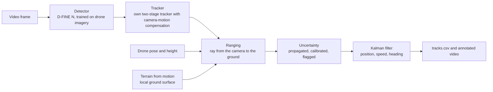

<div align="center">

# Drone Ranger

**Detect and track people and vehicles from a single drone camera, estimate how far away each one is with an error bar; built to run on a Raspberry Pi 5 with no GPU.**

**[Luke Andrew](https://lukeandrew.dev)**


<sub>Version 2 on VisDrone test-dev, the held-out test set, replayed from its one-time test run: the D-FINE N detector and the project's own tracker, each colour and number one identity kept across frames. Clips chosen for clarity; across the whole test set, identity F1 is {{RESULT:headline.json#v2.test_vehicle_idf1|.3f}} for vehicles and {{RESULT:headline.json#v2.test_person_idf1|.3f}} for people.</sub>

</div>

## What is new in version 2

| Change | What it means |
|---|---|
| **Permissive from end to end** | Detector (D-FINE N, Apache-2.0), tracker and pipeline contain no copyleft code; the repository is Apache-2.0 |
| **Built for a Raspberry Pi 5** | One container image for x86-64 and ARM64; on ARM64 it gives the same detections, tracks and ranges as on x86. Pi speed is estimated until measured on a device |
| **More small people detected** | The detector finds {{RESULT:headline.json#v2.test_person_det_recall_16_32|.0%}} of people 16 to 32 pixels tall, against {{RESULT:headline.json#v2.test_v1_person_det_recall_16_32|.0%}} for version 1; the tracker does not yet keep most of them (see below) |
| **Its own tracker** | Two-stage association with camera-motion compensation, written for this project, no appearance features |

## Results at a glance

Every number on this page is generated from a results file in [`results/`](results/) by code in this repository. Each test split was run once, after all settings were frozen.

| | Result | Data |
|---|---|---|
| **Distance accuracy** | Median error **{{RESULT:headline.json#midair_test.paired_terrain_median|.1%}}** (95 % interval {{RESULT:headline.json#midair_test.paired_terrain_median_ci.0|.1%}} to {{RESULT:headline.json#midair_test.paired_terrain_median_ci.1|.1%}}) against {{RESULT:headline.json#midair_test.paired_flat_median|.1%}} for flat ground given the true height, on the same samples; 90th percentile {{RESULT:headline.json#midair_test.paired_terrain_p90|.0%}} against {{RESULT:headline.json#midair_test.paired_flat_p90|.0%}} | Mid-Air, {{RESULT:headline.json#midair_test.n_test_flights|d}} synthetic test flights with exact truth; the {{RESULT:headline.json#midair_test.paired_share|.0%}} of samples where both methods give an answer |
| **With realistic errors** | With assumed typical navigation errors the median rises to **{{RESULT:headline.json#robustness.nav_typical_terrain|.1%}}** (flat ground: {{RESULT:headline.json#robustness.nav_typical_flat|.0%}}); ranging a detected car's box rather than a ground point adds a {{RESULT:headline.json#robustness.car_contact_median_abs|.0%}} short bias, {{RESULT:headline.json#robustness.car_end_to_end_median|.1%}} end to end even with exact poses | Mid-Air, {{RESULT:headline.json#robustness.n_dev_flights|d}} development flights; simulated boxes |
| **Error bars** | After calibration, nominal 90 % intervals contain the truth **{{RESULT:headline.json#midair_test.cov_cal_90|.0%}}** of the time ({{RESULT:headline.json#midair_test.cov_raw_90|.0%}} before): short of 90 %, a sign that flights differ more than calibration assumes | Mid-Air test |
| **Tracking** | Identity F1 **{{RESULT:headline.json#v2.test_vehicle_idf1|.3f}}** for vehicles, {{RESULT:headline.json#v2.test_person_idf1|.3f}} for people, with a detector and tracker that contain no copyleft code; {{RESULT:headline.json#v2.test_person_det_recall_16_32|.0%}} of people 16 to 32 pixels tall are detected but only {{RESULT:headline.json#v2.test_person_recall_16_32|.0%}} tracked. Version 1 reached {{RESULT:headline.json#visdrone_test.vehicle_idf1|.3f}} and {{RESULT:headline.json#visdrone_test.person_idf1|.3f}} at higher input resolution, with AGPL-licensed code ([version 1 results](#version-1-results)) | VisDrone test-dev, run once |
| **End to end** | Ranges of found objects within **{{RESULT:syndrone/test/eval_p10_v2_cal.json#person.pooled.range_rel_err_median_abs|.1%}}** (people) and **{{RESULT:syndrone/test/eval_p10_v2_cal.json#vehicle.pooled.range_rel_err_median_abs|.1%}}** (vehicles) median, calibrated error bars holding (90 % intervals: {{RESULT:syndrone/test/eval_p10_v2_cal.json#person.pooled.range_calibrated_coverage_0.90|.0%}} and {{RESULT:syndrone/test/eval_p10_v2_cal.json#vehicle.pooled.range_calibrated_coverage_0.90|.0%}}); but people found only **{{RESULT:syndrone/test/search_p10_v2_cal.json#person.by_height.h20.found_share|.0%}}** of the time from 20 m, {{RESULT:syndrone/test/search_p10_v2_cal.json#person.by_height.h50.found_share|.0%}} from 50 m and {{RESULT:syndrone/test/search_p10_v2_cal.json#person.by_height.h80.found_share|.1%}} from 80 m, with {{RESULT:syndrone/test/search_p10_v2_cal.json#person.pooled.false_alarms_per_km2|,.0f}} false person tracks per km2; vehicles found {{RESULT:syndrone/test/search_p10_v2_cal.json#vehicle.by_height.h80.found_share|.0%}} to {{RESULT:syndrone/test/search_p10_v2_cal.json#vehicle.by_height.h50.found_share|.0%}} at every height | SynDrone, 3 rendered test towns, 9 flights, exact poses, run once |
| **Search with several drones** | Sharing what each drone has seen lets four map-guided drones find a missing person sooner (mean time to find **{{RESULT:multi_drone/test_p10_v2_cal.json#results.chosen_share_n4.restricted_mean_time_s|,.0f}} s** against {{RESULT:multi_drone/test_p10_v2_cal.json#results.chosen_noshare_n4.restricted_mean_time_s|,.0f}} s without sharing), and losing a quarter of radio packets costs nothing measurable, though too little bandwidth undoes the gain; but a plain lawnmower sweep, one strip per drone, is faster still (**{{RESULT:multi_drone/test_p10_v2_cal.json#results.lawnmower_n4.restricted_mean_time_s|,.0f}} s**), because the detector's false alarms ({{RESULT:multi_drone/sensor_p10_v2_cal.json#by_height.h20.false_alarms_per_km2|,.0f}} per km2 from 20 m) keep pulling map-guided drones back to check them ([multi-drone search](docs/multi_drone.md)) | Simulation with the camera measured on SynDrone, 300 searches per setting, run once |
| **Real footage** | Parked vehicles' positions repeat to **{{RESULT:headline.json#auair.heldout_rel_all|.1%}}** of their distance (repeatability, not accuracy); version 1's detector reaches AP50 only **{{RESULT:headline.json#auair.heldout_vehicle_ap50|.2f}}** for vehicles and {{RESULT:headline.json#auair.heldout_person_ap50|.2f}} for people here | AU-AIR, held-out flights |
| **Speed** | **{{RESULT:headline.json#v2.val_dfine_n_640_laptop_fps|.1f}} frames per second** on a laptop CPU with detection on every second frame. On a Raspberry Pi 5 the detector is *estimated* (not measured) at about {{RESULT:headline.json#v2.val_dfine_n_640_pi_ms|.0f}} ms per frame; the same program runs on ARM64 with outputs matching x86 | {{RESULT:headline.json#edge.cpu|s}}, no GPU; ARM64 under emulation |

## How it works



A camera gives direction, not distance. Each tracked box's ground-contact point is turned into a ray and intersected with the ground: either a flat plane, or a local surface triangulated from image features tracked across frames using the drone's known motion ("terrain from motion"), which needs no height above the ground. Sensor noise is propagated to every range, the intervals are calibrated on separate flights (split conformal prediction), and a small, interpretable model flags estimates that are likely to be badly wrong.

## 1. Detect and track

<table>
<tr>
<td width="50%"></td>
<td width="50%"></td>
</tr>
<tr>
<td><sub>Choosing the detector: accuracy against estimated Pi 5 time, validation data.</sub></td>
<td><sub>People found by size on the test set: detected in single frames, and kept by a track.</sub></td>
</tr>
</table>

Version 2 replaces version 1's detector and tracker, which came from an AGPL-licensed library, with code that can go into a closed product: a D-FINE N detector (Apache-2.0) trained on VisDrone, and the project's own two-stage tracker with camera-motion compensation and no appearance features. Candidates were trained with the same budget and compared on validation with the tracker tuned for each. RF-DETR Nano tracks best (mean IDF1 {{RESULT:headline.json#v2.val_rfdetr_nano_640_idf1|.3f}} at 640 pixels, {{RESULT:headline.json#v2.val_rfdetr_nano_960_idf1|.3f}} at 960) but is estimated at {{RESULT:headline.json#v2.val_rfdetr_nano_640_pi_ms|,.0f}} ms per frame or more on a Raspberry Pi 5 CPU, because its vision-transformer backbone costs about 115 billion operations per frame at 640. D-FINE N ({{RESULT:headline.json#v2.val_dfine_n_640_idf1|.3f}}, about {{RESULT:headline.json#v2.val_dfine_n_640_pi_ms|.0f}} ms) is the only candidate near live speed on the Pi without an add-on accelerator, so it was chosen ([decision D-729](docs/decisions.md)). On validation it matches version 1's live 640-pixel setting ({{RESULT:headline.json#v2.val_v1_640_idf1|.3f}}) and detects {{RESULT:headline.json#v2.val_dfine_n_640_p16|.0%}} of people 16 to 32 pixels tall against {{RESULT:headline.json#v2.val_v1_640_p16|.0%}}.

On the held-out test set, run once after every setting was frozen, version 2 reaches identity F1 {{RESULT:headline.json#v2.test_vehicle_idf1|.3f}} for vehicles (MOTA {{RESULT:headline.json#v2.test_vehicle_mota|.3f}}) and {{RESULT:headline.json#v2.test_person_idf1|.3f}} for people (MOTA {{RESULT:headline.json#v2.test_person_mota|.3f}}). That is below version 1's published test result, which used its slower 960-pixel model. Small people are the clearest weakness: the detector finds {{RESULT:headline.json#v2.test_person_det_recall_16_32|.0%}} of people 16 to 32 pixels tall in single frames (version 1: {{RESULT:headline.json#v2.test_v1_person_det_recall_16_32|.0%}}), but only {{RESULT:headline.json#v2.test_person_recall_16_32|.0%}} are tracked ({{RESULT:headline.json#v2.test_person_recall_128|.0%}} above 128 pixels), because the tracker thresholds, chosen for the best mean IDF1, start a track only on confident detections. These numbers are not compared with published VisDrone tracking results, whose protocol (classes and test split) differs.

## 2. Range with honest uncertainty

<table>
<tr>
<td width="42%"></td>
<td></td>
</tr>
</table>

On synthetic flights, where the true distance of every pixel is known, each dot is a range estimate that stays on its spot on the ground: **circles** were within 10 % of the truth and **crosses** were not; **amber** means the reliability flag was raised. Compared on the same samples with flat ground given the true height (a height a real drone does not have), terrain from motion has a median error of {{RESULT:headline.json#midair_test.paired_terrain_median|.1%}} against {{RESULT:headline.json#midair_test.paired_flat_median|.1%}} and is closer on {{RESULT:headline.json#midair_test.paired_terrain_closer|.0%}} of samples; it has the lower median on {{RESULT:headline.json#midair_test.paired_flights_better|d}} of {{RESULT:headline.json#midair_test.paired_n_flights|d}} flights, but not on flight {{RESULT:headline.json#midair_test.paired_worst_flight|d}} ({{RESULT:headline.json#midair_test.paired_worst_flight_terrain|.1%}} against {{RESULT:headline.json#midair_test.paired_worst_flight_flat|.1%}}), and one estimate in ten is still more than {{RESULT:headline.json#midair_test.paired_terrain_p90|.0%}} off. Its error stays at or below {{RESULT:headline.json#midair_test.terrain_err_slope_30_45|.1%}} on slopes up to 45°; a flat-ground model, even given the true height, grows from {{RESULT:headline.json#midair_test.flat_err_slope_0_5|.0%}} on level ground to {{RESULT:headline.json#midair_test.flat_err_slope_45_90|.0%}} on slopes above 45°. After calibration, 90 % error bars hold only {{RESULT:headline.json#midair_test.cov_cal_90|.0%}} of the time: calibration assumes the test flights resemble the calibration flights, and the shortfall shows they do not quite; the flag (AUROC {{RESULT:headline.json#midair_test.flag_auroc|.2f}}) catches {{RESULT:headline.json#midair_test.flag_recall|.0%}} of estimates more than 10 % off.

### How far the number transfers

The figures above give the method the simulator's exact camera poses and an ideal camera. A real drone's navigation is not exact, so every pose the method uses was perturbed and the development flights re-run ([pose sweep](scripts/terrain_pose_sweep.py)). On these development flights, exact poses give {{RESULT:headline.json#robustness.exact_terrain|.1%}} for terrain from motion and {{RESULT:headline.json#robustness.exact_flat|.1%}} for flat ground given the true height (the test-flight figures above are on different flights and samples).

<p align="center">
  
</p>

- **Errors shared by every frame do not matter much.** A 5 m GPS offset leaves terrain from motion at {{RESULT:headline.json#robustness.pos_bias_5m_terrain|.1%}} (flat ground: {{RESULT:headline.json#robustness.pos_bias_5m_flat|.0%}}), and a 2° tilt error raises it only to {{RESULT:headline.json#robustness.att_bias_2deg_terrain|.1%}}, because the camera and the triangulated ground move together.
- **Errors that change from frame to frame matter a lot.** Triangulation uses frames 0.04 to 0.4 s apart, so it needs the change in pose between them to be accurate: per-frame position noise of 2 cm gives {{RESULT:headline.json#robustness.pos_jitter_0p02m_terrain|.1%}}, 10 cm gives {{RESULT:headline.json#robustness.pos_jitter_0p1m_terrain|.1%}} (worse than flat ground with the true height, {{RESULT:headline.json#robustness.pos_jitter_0p1m_flat|.0%}}), and attitude noise of 0.1° gives {{RESULT:headline.json#robustness.att_jitter_0p1deg_terrain|.1%}}. In practice this calls for the short-term accuracy of an inertial or visual-inertial navigation system, not raw GNSS.
- **Three assumed navigation grades** (combining both kinds of error; assumptions, not product specifications) give {{RESULT:headline.json#robustness.nav_good_terrain|.1%}}, {{RESULT:headline.json#robustness.nav_typical_terrain|.1%}} and {{RESULT:headline.json#robustness.nav_poor_terrain|.0%}}, against {{RESULT:headline.json#robustness.nav_good_flat|.0%}}, {{RESULT:headline.json#robustness.nav_typical_flat|.0%}} and {{RESULT:headline.json#robustness.nav_poor_flat|.0%}} for flat ground given the true height.
- **The box adds its own error.** The pipeline ranges a detected box's bottom-centre, which for a car seen at an angle is the near edge, not the centre. Simulated cars with the detector's measured box noise read {{RESULT:headline.json#robustness.car_contact_median_abs|.1%}} short (people {{RESULT:headline.json#robustness.person_contact_median_abs|.1%}}); combined with the ranging error, a car is {{RESULT:headline.json#robustness.car_end_to_end_median|.1%}} off at the median and more than {{RESULT:headline.json#robustness.car_end_to_end_p90|.0%}} off one time in ten, even with exact poses.

Lens distortion, rolling shutter and focal-length error are not modelled: Mid-Air renders an ideal camera.

## 3. Real footage

<table>
<tr>
<td width="50%"></td>
<td width="50%"></td>
</tr>
</table>

AU-AIR records real flights with GPS and altitude but no camera calibration and no camera tilt, so both were estimated: the focal length from GPS motion against image motion on separate calibration flights ({{RESULT:headline.json#auair.focal_px|.0f}} px), and the tilt, frame by frame, from the motion of the ground in the footage itself ([camera model](docs/auair_camera_model.md)). On held-out flights, parked vehicles' estimated positions repeat to {{RESULT:headline.json#auair.heldout_rel_all|.1%}} of their distance ({{RESULT:headline.json#auair.heldout_segments|d}} vehicle segments). There is no ground truth here, so this is repeatability, not accuracy. The detector itself transfers poorly to this footage: AP50 {{RESULT:headline.json#auair.heldout_vehicle_ap50|.2f}} for vehicles and {{RESULT:headline.json#auair.heldout_person_ap50|.2f}} for people on the held-out flights, partly because AU-AIR's boxes are drawn looser than VisDrone's (D-512); the rest is a genuine gap between the two datasets, and many vehicles are missed. Two further warning signs: the tilt is estimated from the same footage it is used on, and {{RESULT:headline.json#auair.vehicle_share_above_70|.0%}} of vehicle tracks imply speeds above 70 km/h at a junction where that is implausible, most likely from shallow lines of sight and identity switches.

## 4. Speed on a laptop CPU

<p align="center">
  
</p>

Every setting was measured on the same laptop CPU ({{RESULT:headline.json#edge.cpu|s}}). At full accuracy (ONNX, 960-pixel input, detection on every frame) the pipeline runs at **{{RESULT:headline.json#edge.accurate_fps|.1f}} frames per second** (mean IDF1 on validation {{RESULT:headline.json#edge.accurate_idf1|.3f}}). To reach video rate, a 640-pixel input, detection on every second frame (the tracker predicts in between) and detection overlapped with tracking give {{RESULT:headline.json#edge.fast_fps|.1f}} frames per second, at the cost of mean validation IDF1 {{RESULT:headline.json#edge.fast_idf1|.3f}}. Each frame's result then arrives {{RESULT:headline.json#edge.fast_latency_median_ms|.0f}} ms after capture (median), so 30 fps is met in throughput, not in per-frame delay. These figures are for version 1's detector and tracker.

**Version 2 and the Raspberry Pi 5.** With the D-FINE N detector the pipeline runs at {{RESULT:headline.json#v2.val_dfine_n_640_laptop_fps|.1f}} frames per second on the same laptop (detection on every second frame). No Pi 5 was available, so its speed is *estimated, not measured*: a published Pi 5 timing of a reference model, timed the same way on the laptop, scales each laptop timing (D-723), giving about {{RESULT:headline.json#v2.val_dfine_n_640_pi_ms|.0f}} ms per frame for the detector alone, with an assumed range of 0.75 to 1.5 times that. The package's container image builds for x86-64 and ARM64; run under emulation on the same frames, the ARM64 image's detections, tracks and ranges match the x86 image's within stated tolerances ([platform check](scripts/platform_check.py)). `make pi-benchmark` measures the real speed on a device.

## Quick start

Python 3.12. On Linux or macOS:

```bash
python3.12 -m venv .venv
.venv/bin/python -m pip install -r requirements-lock.txt
.venv/bin/python -m pip install -e . --no-deps
.venv/bin/python -m pytest                      # the test suite
.venv/bin/aerialrange demo --out cache/demo     # synthetic flight, no datasets or model needed
```

On Windows, use `py -3.12 -m venv .venv` and `.venv\Scripts\` in place of `.venv/bin/`.

The demo runs tracking, ranging, the Kalman filter and the overlay on a synthetic flight whose boxes are supplied directly (the detector is not run), writes `tracks.csv`, `annotated.mp4` and `timing.json`, and checks every distance and speed against the synthetic truth.

### On a Raspberry Pi 5, or anywhere with Docker

The runtime image holds the package and its pinned dependencies only (no PyTorch); weights and frames are mounted at run time.

```bash
docker buildx build --platform linux/arm64 -f docker/Dockerfile -t aerialrange:arm64 --load .
docker run --rm -v "$PWD/weights:/app/weights:ro" -v "$PWD/cache:/app/cache" aerialrange:arm64 \
    aerialrange demo --out cache/demo
make pi-benchmark        # on the Pi itself: measured speed, replacing the estimate
```

### Model weights

The detector is published as ONNX files on the [Releases page](../../releases/latest): `dfine_n_640.onnx` (version 2, the default in `configs/run.yaml`) and version 1's `B2_yolo26n_960w_640_rect.onnx` and `B2_yolo26n_960_rect.onnx` (reference only). Download them into a `weights/` folder at the repository root. They were trained on VisDrone, which is licensed for research only, so **the weights are for research and evaluation only**.

With the weights in place, run on a real flight (frames or a video, plus a flight-data CSV with position, height, heading and camera tilt per frame):

```bash
.venv/bin/aerialrange run --source <frames-or-video> --metadata <flight.csv> --out cache/run
```

## Documentation

| Document | What it covers |
|---|---|
| [Technical brief](docs/brief.md) | Two-page summary: problem, method, results, failure modes |
| [Limitations, and questions and answers](docs/limitations.md) | Where it breaks, by how much, and the questions an engineer is likely to ask |
| [Model and data](docs/model_and_data.md) | Detector, tracker, datasets and licences |
| [AU-AIR camera model](docs/auair_camera_model.md) | Focal length, tilt and altitude inferred from footage |
| [Hypotheses H6 to H12](docs/hypotheses.md) | Each version 2 hypothesis, its test and its outcome |
| [Multi-drone search](docs/multi_drone.md) | Simulated search by a team of drones sharing observations over a lossy radio (Phase 14) |
| [Thermal detection](docs/thermal.md) | Thermal detector and tracker on HIT-UAV and BIRDSAI (Phase 13, in progress) |
| [Decision log](docs/decisions.md) | Every design choice, with its reason and evidence |
| [Runbook](docs/runbook.md) | The commands that reproduce each result, in order |

## Repository layout

| Path | Contents |
|---|---|
| `src/aerialrange/geometry/` | Camera model, ranging, uncertainty propagation, triangulation, terrain fitting, Kalman filter (built test-first) |
| `src/aerialrange/track/`, `detect/` | Tracking, evaluation, tiling, saved-detection replay |
| `src/aerialrange/evaluate/` | Mid-Air and AU-AIR evaluations, conformal calibration, reliability flag, statistics |
| `src/aerialrange/pipeline/` | The end-to-end `aerialrange run` and `demo` |
| `src/aerialrange/edge/` | Latency benchmark harness |
| `scripts/` | One script per experiment |
| `configs/` | Every setting, each with its source |
| `results/` | Every number and figure quoted in the documents |


## Version 1 results

Version 1 used a YOLO26n detector fine-tuned on VisDrone with Ultralytics' BoT-SORT tracker. On VisDrone test-dev (run once) it reached identity F1 {{RESULT:headline.json#visdrone_test.vehicle_idf1|.3f}} for vehicles (MOTA {{RESULT:headline.json#visdrone_test.vehicle_mota|.3f}}) and {{RESULT:headline.json#visdrone_test.person_idf1|.3f}} for people, with {{RESULT:headline.json#visdrone_test.person_recall_16_32|.0%}} of people 16 to 32 pixels tall tracked ({{RESULT:headline.json#visdrone_test.person_recall_128|.0%}} above 128). Fine-tuning on drone imagery raised mean validation IDF1 from {{RESULT:headline.json#visdrone_val.b0_cmc_mean_idf1|.2f}} to {{RESULT:headline.json#visdrone_val.b2_960_tuned|.2f}}. On the laptop CPU it ran at {{RESULT:headline.json#edge.accurate_fps|.1f}} frames per second at full accuracy and {{RESULT:headline.json#edge.fast_fps|.1f}} in its fastest setting.

<p align="center">
  
</p>

<p align="center">
  
</p>

Version 1's test-dev run (night clip, held out) and, on a validation clip, the off-the-shelf detector (left) against the fine-tuned one (right).

## The main gap

**Finding people from above 20 m.** The whole pipeline has now been scored end to end against known distances, once, on three held-out SynDrone towns ([docs/syndrone_eval.md](docs/syndrone_eval.md), Phase 10). Where an object is found, its distance is right: median error under 1 % for people and vehicles, with error bars that hold on unseen towns. But people are found {{RESULT:syndrone/test/search_p10_v2_cal.json#person.by_height.h20.found_share|.0%}} of the time from 20 m, {{RESULT:syndrone/test/search_p10_v2_cal.json#person.by_height.h50.found_share|.0%}} from 50 m and almost never from 80 m, and most person tracks are false alarms ({{RESULT:syndrone/test/search_p10_v2_cal.json#person.pooled.false_alarms_per_km2|,.0f}} per km2 searched, in mostly urban towns). Vehicles are found {{RESULT:syndrone/test/search_p10_v2_cal.json#vehicle.by_height.h80.found_share|.0%}} to {{RESULT:syndrone/test/search_p10_v2_cal.json#vehicle.by_height.h50.found_share|.0%}} of the time at every height. For search and rescue, where a missed person costs most and each false alarm costs a crew's time, person detection is the gap. The multi-drone simulation (Phase 14) shows the cost directly: false alarms make map-guided search slower than a plain sweep.

Two more limits stand behind it. These are rendered towns with exact camera poses; real navigation errors move ranges by several per cent and the error bars must be refitted for them. And the only real footage (AU-AIR) has no true distances. The next steps are thermal imaging (Phase 13), where people stand out against cool ground, and a real flight past objects with known positions.

Version 1's gap, now closed by this test: no single test ran detect, track and range end to end against known object distances.

## Scope

A perception and measurement project on public research datasets. People and vehicles are tracked as boxes only: no face analysis and no re-identification by appearance. Distances hold under stated assumptions (a known camera and pose, and flat ground or terrain from motion) and are not claimed beyond the tested conditions: low altitude ({{RESULT:headline.json#auair.alt_min_m|.0f}} to {{RESULT:headline.json#auair.alt_max_m|.0f}} m on real footage), short ranges, and one site for real footage.

## Datasets and credits

No datasets or model weights are stored in this repository; the short clips in `docs/media/` contain frames from the datasets below and are shared under their terms.

- **VisDrone2019**: P. Zhu, L. Wen, D. Du et al., "Detection and tracking meet drones challenge", *IEEE TPAMI*, 2021. Research use.
- **Mid-Air**: M. Fonder and M. Van Droogenbroeck, "Mid-Air: a multi-modal dataset for extremely low altitude drone flights", *CVPR Workshops*, 2019. CC BY-NC-SA 4.0.
- **AU-AIR**: I. Bozcan and E. Kayacan, "AU-AIR: a multi-modal unmanned aerial vehicle dataset for low altitude traffic surveillance", *ICRA*, 2020. CC BY 4.0.
- **SynDrone**: G. Rizzoli, F. Barbato, M. Caligiuri and P. Zanuttigh, "SynDrone: multi-modal UAV dataset for urban scenarios", *ICCV Workshops*, 2023. Creative Commons Attribution (the authors' statement; no version given).
- **HIT-UAV**: J. Suo, T. Wang, X. Zhang, H. Chen, W. Zhou and W. Shi, "HIT-UAV: a high-altitude infrared thermal dataset for unmanned aerial vehicle-based object detection", *Scientific Data* 10, 227, 2023. CC BY 4.0.
- **BIRDSAI**: E. Bondi, R. Jain, P. Aggrawal, S. Anand, R. Hannaford, A. Kapoor, J. Piavis, S. Shah, L. Joppa, B. Dilkina and M. Tambe, "BIRDSAI: a dataset for detection and tracking in aerial thermal infrared videos", *WACV*, 2020. Hosted by LILA as Conservation Drones; Community Data License Agreement (permissive).
- **Lost-person statistics** for the search simulation: R. J. Koester, *Lost Person Behavior Instructor Activity Guide*, 2010; the distance-ring model as in E. Sava, C. Twardy, R. Koester and M. Sonwalkar, *Transactions in GIS* 20(1), 2016.
- **D-FINE**: Y. Peng, H. Li, P. Wu, Y. Zhang, X. Sun and F. Wu, "D-FINE: redefine regression task in DETRs as fine-grained distribution refinement", *ICLR*, 2025. Code and COCO weights Apache-2.0.
- Version 1's detector and trackers: [Ultralytics](https://github.com/ultralytics/ultralytics) (AGPL-3.0), used only by version 1's scripts in a separate environment.

## Licence

[Apache License 2.0](LICENSE), from version 2 onwards; see [NOTICE](NOTICE) for the vendored HOTA metric (MIT). Earlier commits, built on Ultralytics, remain available under AGPL-3.0. The package does not import Ultralytics: the detector runs through ONNX Runtime in the project's own code and the tracker is the project's own. Version 1's reproduction scripts still need Ultralytics (AGPL-3.0) from a separate environment (`requirements-v1.txt`), and running them is subject to AGPL-3.0 for that combination. The licence covers the code, not the model weights or the datasets, which keep their own terms.

## How this was built

I set the scope and requirements and made the decisions that shape the results: which questions to answer, which datasets to use and how to split them, what counts as a fair baseline, what counts as a large error, and when a result was solid enough to report. I sourced the data, ran the detector training on Kaggle GPUs and hand-labelled the camera tilt of the AU-AIR clips. I used Claude (Anthropic's AI model) as a coding agent to write most of the implementation and run the experiments to that specification. I reviewed the results at each stage, and every decision is recorded with its reason in the [decision log](docs/decisions.md).

## Author

**Luke Andrew**, [lukeandrew.dev](https://lukeandrew.dev), [GitHub](https://github.com/LukeA77).
